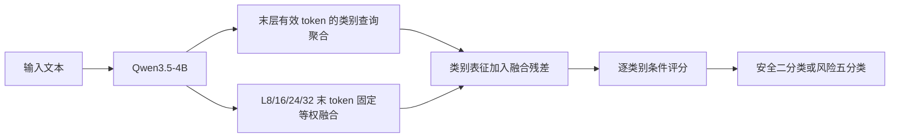

# hanguard

**面向大语言模型应用的中文输入安全分类器。**

hanguard 对输入文本进行有害／无害判断，并为有害文本识别一个主要风险类别。当前研究基于 Qwen3.5-4B，结合**类别查询注意力聚合（CQA）与固定多层残差融合（MLF）**，分别开展安全二分类和风险五分类消融。仓库同时保留已有部署包的命令行、批量处理和 HTTP 接口。

[实验结果](#实验结果) · [模型方法](#模型方法) · [快速开始](#快速开始) · [使用方式](#使用方式) · [数据集](#数据集) · [训练与评估](#训练与评估) · [仓库导航](#仓库导航)

| 目的 | 从这里开始 |
|---|---|
| 写论文实验部分 | [实验正文草稿](docs/paper_experiments_20261025.md)与[CSV／LaTeX结果包](experiment_results/20261025_paper_ready/README.md) |
| 查看全部实验及证据范围 | [结果目录](experiment_results/README.md)与[补充证据](docs/paper_supporting_evidence_20261025.md) |
| 定位复现代码 | [脚本导航](scripts/hanguard/README.md)与[实验索引](docs/experiment_index.md) |
| 查数据与其他文档 | [数据导航](data/README.md)与[文档导航](docs/README.md) |

## 功能

- **有害识别与风险分类**：输出有害判断、主要类别及对应概率，支持五类风险标签。
- **共享模型计算**：两个分类头共用一次骨干前向计算，直接从文本特征产生预测。
- **多种接入方式**：支持单条文本、交互式输入、批量文件和常驻 HTTP 服务。
- **完整文本处理**：支持最多 4,096 token 的输入；超长文本明确报错，不自动截断。

## 快速开始

本节演示已有兼容部署包。该运行时和导出流程与当前论文分类组件的权重格式不同，不能直接用论文实验检查点替换部署文件；论文方法与结果见下方对应章节。

### 安装

运行环境为 Python 3.10、支持 BF16 的 CUDA GPU。依赖包括 PyTorch 2.6.0 和 Transformers 5.3.0，完整版本见 [requirements.txt](requirements.txt)。

```bash
git clone https://github.com/HDURAIN/HanGuard.git
cd HanGuard
python3.10 -m venv .venv-hanguard
source .venv-hanguard/bin/activate
python -m pip install -r requirements.txt
```

### 准备模型

推理需要 [Qwen3.5-4B 基座](https://huggingface.co/Qwen/Qwen3.5-4B)和 hanguard 推理包，按以下结构放置：

```text
models/
├── Qwen3.5-4B/          # 完整基座权重、配置和 tokenizer
└── hanguard/
    ├── model.json      # 模型配置、分类阈值与文件校验信息
    ├── binary_adapter.pt
    ├── binary_head.pt
    └── category_head.pt
```

Git 仓库包含代码、数据元信息和文档，未提供 hanguard 推理包与正式语料的下载入口。运行前需另行取得模型文件，或在备齐数据后通过[训练与导出流程](#训练与评估)生成推理包。加载器读取本地文件，并校验模型配置与权重是否匹配。

### 运行

```bash
python infer.py --text '请介绍如何识别网络诈骗，并保护自己的个人信息。'
```

输出示例：

```text
无害
安全
```

运行内置演示：

```bash
python demo_infer.py
```

## 使用方式

### 命令行与批量推理

```bash
# 输出 JSON，包含标签和概率
python infer.py --text '请根据公司公开年报，总结它的主要业务。' --json

# 交互式输入，输入 /quit 退出
python infer.py --interactive

# 批量文件，每条记录包含 prompt 字段
python infer.py --input examples/prompts.jsonl \
  --output outputs/predictions.jsonl --batch-size 8
```

批量输入和输出支持 CSV、Parquet、JSON、JSONL。使用 `--model /path/to/model.json` 指定推理包，使用 `--device cuda:0` 指定设备。更多输入示例见 [examples](examples/README.md)。

### HTTP 服务

```bash
python server.py --host 127.0.0.1 --port 8000
```

发送请求：

```bash
curl -s http://127.0.0.1:8000/classify \
  -H 'Content-Type: application/json' \
  -d '{"prompt":"请介绍个人信息保护的基本原则。"}'
```

| 接口 | 用途 |
|---|---|
| `POST /classify` | 单条分类，请求体为 `{"prompt":"文本"}` |
| `POST /classify/batch` | 批量分类，请求体为 `{"prompts":["文本一","文本二"]}` |
| `GET /health` | 服务存活检查 |
| `GET /ready` | 模型就绪检查 |

单条 JSON 结果包含 `safety_label`、`category_id`、`category_label`、`harmful_probability` 和 `category_probabilities` 等字段。五类概率表示类型头的预测分布；最终是否有害由二分类概率与阈值决定。

### 风险类别

| ID | 类别 |
|---|---|
| 0 | 安全 |
| 1 | 违反社会主义核心价值观的内容 |
| 2 | 歧视性内容 |
| 3 | 商业违法违规 |
| 4 | 侵犯他人合法权益 |
| 5 | 无法满足特定服务类型的安全需求 |

类型头预测 1–5 中的一个主要类别；当二分类判为无害时，最终类别为 0。类别定义沿用数据来源标签，标准框架及边界说明见[类别标准](docs/primary_category_standard_review.md)。

## 模型方法

当前论文方法固定预训练骨干参数，仅优化查询、投影、融合及分类组件。两个任务各自训练分类头，分别使用2个安全类别查询或5个风险类别查询：



**类别查询注意力聚合（CQA）**为每个类别学习查询，对末层有效 token 分别计算注意力，得到每类文本表征，再由共享参数的类别条件评分器输出各类分数。查询与分类组件联合训练，不是预先编码的类别描述或文本摘要。

**固定多层残差融合（MLF）**提取第8、16、24、32层的最后有效token，经独立投影后按各0.25的固定权重融合，再通过残差映射加入类别表征。固定的是层混合系数，投影与残差映射参与训练。完整公式与四组结构见[实验正文](docs/paper_experiments_20261025.md)。已有兼容部署包的结构另见[历史评测与实现说明](docs/benchmarks.md)。

## 数据集

数据由 **WildGuard 中文翻译语料、中文整理语料和 JailBench** 组成。新版经过独立来源核验、翻译整改及整组重新切分；二分类保留原来源标签，未知类型单独mask。数据说明见 [20261012整改发布](data/three_source_remediated_20261012/README.md)。

| 任务 | 来源 | 训练集 | 验证集 | 测试集 |
|---|---|---:|---:|---:|
| 有害／无害识别 | 三个来源 | 66,802 | 8,350 | 8,350 |
| 五类主要风险识别 | 中文整理语料与 JailBench 的已知有害类型 | 17,440 | 2,180 | 2,180 |

两任务采用不同的监督范围：二分类使用全部来源，类型分类使用两来源的既有主要类别标签。数据字段、文件准备与质量说明见[数据文档](docs/data.md)，翻译方法见[翻译处理说明](docs/translation_repair.md)。

## 实验结果

论文写作请从[20261025实验正文草稿](docs/paper_experiments_20261025.md)和[论文结果包](experiment_results/20261025_paper_ready/README.md)开始：统一采用类别查询注意力聚合（CQA）与固定多层残差融合（MLF）命名，整理四组主消融、原生Qwen3Guard比较、CSV/LaTeX表和补充证据；不混用下方历史表格。

当前主实验 **20261022 全新消融重跑已完成**：两个任务各9组、seeds 42/43/44，共54个正式分类头和192个全层线性probe。二分类测试8,350条，五分类测试2,180条；两任务独立评价。以下为三个种子的均值±样本标准差，单位%。

| 配置 | 二分类Accuracy | 有害F1 | 五分类Accuracy | 五分类Macro-F1 |
|---|---:|---:|---:|---:|
| 基础MLP | 93.85±0.10 | 94.43±0.10 | 77.28±0.95 | 76.10±0.85 |
| 仅MLF | 94.91±0.04 | 95.41±0.06 | 77.89±1.62 | 76.37±1.65 |
| 仅CQA | 95.86±0.15 | 96.23±0.15 | 82.20±1.59 | 80.92±1.83 |
| **CQA＋MLF** | **96.12±0.25** | **96.48±0.23** | **83.13±0.87** | **81.79±1.14** |

组合相对基础MLP的Accuracy提升为二分类**2.27**、五分类**5.86个百分点**；在CQA基础上增加MLF的平均增量为0.26、0.93个百分点，存在种子波动。通用池化强对照与类别间权衡保留在[补充证据](docs/paper_supporting_evidence_20261025.md)，不将组合总增益全部归于融合或类别向量本身。

原生Qwen3Guard-Gen-4B在同一8,350条上的两种预先固定规则Accuracy为90.86%（仅Unsafe）和94.83%（Unsafe＋Controversial）。它使用官方生成接口直接推理，Hanguard使用本地监督训练分类组件；原生类别与本地五类不一一对应，五分类为N/A。见[原生能力对比](experiment_results/20261025_qwen3guard_clean_test_v2/ORIGINAL_CAPABILITY_COMPARISON.md)。

历史数据上的部署成绩与旧探索不混入此表，统一见[历史评测](docs/benchmarks.md)和[实验结果目录](experiment_results/README.md)。评测使用来源继承标签的固定留出集，不能描述为从未检查过的盲测。

## 训练与评估

**论文实验复现**使用[clean_ablation_study.py](scripts/hanguard/clean_ablation_study.py)，参数、数据和选择规则见[锁定协议](experiment_results/20261022_clean_ablation/artifacts/outputs/hanguard_clean_ablation_20261022/protocol.json)及[脚本导航](scripts/hanguard/README.md)。只校验或重建论文表格可运行以下CPU命令，不会启动训练：

```bash
.venv-hanguard/bin/python scripts/hanguard/package_paper_experiment_materials.py --verify
```

下方为**已有兼容部署包的训练与导出流程**，由`train.py`提供；其优化设置和结构不同，不是生成上方论文四组表格的入口。

准备好[正式三集文件](docs/data.md)与本地基座后，安装训练依赖：

```bash
python -m pip install -r requirements-train.txt
```

以下命令依次训练融合二分类模型、训练类型头并导出推理包：

```bash
python scripts/hanguard/train.py binary run \
  --output outputs/binary --binary-arms E04 --seeds 42 --gpus 0

python scripts/hanguard/train.py category run \
  --output outputs/category \
  --parent-run outputs/binary/runs/E04_s42 --gpus 0

python scripts/hanguard/export_model.py \
  --binary-run outputs/binary/runs/E04_s42 \
  --category-study outputs/category --output models/hanguard
```

`E04` 是多层融合二分类方法的实验标识。类别阶段默认比较三个类型头、各运行三个随机种子；导出器在可学习查询头中按验证交叉熵选择模型。实验和导出均使用新目录。

二分类命令可将 `run` 改为 `dry-run`，先进行 CPU 配置检查；类别阶段的检查仍需已训练好的二分类父模型。完整参数、可选 CUDA 加速、对照设置及断点恢复见[训练指南](docs/training.md)。

评估推理包：

```bash
python evaluate.py \
  --test data/hanguard_two_source_remediated_20261012/test.parquet \
  --output outputs/evaluation/report.json
```

该命令用于上面流程训练出的匹配新版模型。旧推理包应使用匹配的历史测试数据，不能拿新版切分重新评估。评估完整三来源二分类时，将 `--test` 替换为 `data/three_source_remediated_20261012/test.parquet`；未知类型及范围外来源从类型指标排除，二分类保留全部记录。

## 文档与开发

- [文档导航](docs/README.md)：区分当前论文、复现、部署与历史参考。
- [脚本导航](scripts/hanguard/README.md)：所有脚本按用途和状态分类。
- [测试导航](tests/README.md)：当前、部署及历史测试的对应范围。
- [实验结果目录](experiment_results/README.md)：当前证据包与历史归档。
- [训练指南](docs/training.md)：参数、实验注册、检查点选择与恢复。
- [数据文档](docs/data.md)：数据组成、监督范围与复现所需文件。
- [历史实验报告](docs/benchmarks.md)：20260928数据上的部署评测与消融。
- [类别标准](docs/primary_category_standard_review.md)：五个主类的定义与来源差异。

安装训练依赖后，可在 CPU 上运行测试：

```bash
CUDA_VISIBLE_DEVICES='' python -m pytest -q tests
```

## 仓库导航

```text
README.md                 项目、当前结果与主要入口
docs/                     论文、数据、训练及标准说明
scripts/hanguard/         实验、数据与导出源码，按README分类
tests/                    当前与历史实现的CPU回归测试
data/                     发布元信息与来源资料；完整语料本地保存
experiment_results/       可版本管理的协议、结果、预测及校验清单
examples/                 演示输入
archive/                  历史整理记录；压缩包本地保存
models/                   本地模型与部署包，不进入Git
outputs/                  本机特征、权重、日志与运行状态，不进入Git
```

历史脚本与结果保留原路径，协议登记的源码和数据指纹不因目录整理而改变。20261025整理内容与核验记录见[仓库整理记录](docs/repository_cleanup.md)。
